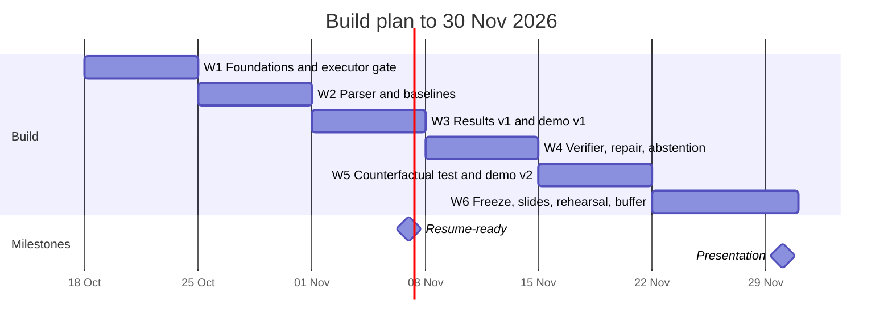

# Project plan: Verifiable Knowledge-Graph QA (Project #8)

> New to the problem? Read [docs/01-problem-explained.md](docs/01-problem-explained.md) first.

## Context

| | |
|---|---|
| Who | Solo, final year, campus placements ongoing |
| Deadline | **Presentation on 30 Nov 2026** (a live demo is a plus) |
| Target | **Product AI roles** (AI Engineer / ML Engineer), so no research paper for now |
| Hardware | Laptop RTX 3050 **4 GB VRAM**, **16 GB RAM**; free Kaggle and Colab; free LLM APIs |

## Positioning

- **Course title:** *When to Trust the Knowledge Graph: Neuro-Symbolic Multi-Step QA over Wikidata under Counterfactual Facts*
- **Resume / GitHub title:** *Verifiable Knowledge-Graph QA Agent: LLM-to-program compilation, symbolic execution, verification and abstention*
- **Pitch:** a QA engine over a Wikidata knowledge graph. It compiles questions into executable programs, shows its work, follows the data when facts change, and says "I don't know" when it should. It is benchmarked against an LLM given exactly the same facts.

## Scope

**Must have (the presentation needs these)**

- KQA Pro data and the KoPL engine (reused and credited), with an **executor gate**: gold programs reproduce about 100% of gold answers.
- **Parser:** fine-tuned BART-base, building on the KQAPro_Baselines code (reused and credited).
- **Baselines** on one pinned open 7–8B model:
  - Baseline A: closed-book (memory only).
  - **Baseline B: the same facts given as text** (the main comparison).
- **Evaluation harness:**
  - a fixed stratified sample from the validation set (the test answers are hidden);
  - every LLM call cached;
  - 95% confidence intervals;
  - results split by number of steps and by question type.
- **Error attribution:** swap in gold pieces step by step.
- **Verifier + repair loop** (at most 2 tries) and **abstention** (do several sampled programs agree, plus empty or wrong-type results).
- **Counterfactual stress test:** edit facts on the program's path, re-run the gold programs, then measure how often each system follows the KB.
- **Local demo** (Gradio): question → program → trace → answer, Baseline B side by side, an "edit this fact" toggle, an abstain badge, and a cached/offline mode.
- README with the results table at the top, plus a "reused vs built" section.

**Stretch (only if ahead of schedule)**

- Missing-fact (deletion) test, including silent failures on counts.
- Few-shot LLM parser vs fine-tuned BART: the accuracy / cost / latency tradeoff.
- Tool-calling agent baseline that uses the same KB functions.
- Cost/latency table and Pareto plot.
- MCP server exposing the KB tools.
- Static "trace explorer" on GitHub Pages for recruiters.

**Out for now:** ProbLog, a fallback router, 2WikiMultiHopQA, Mintaka/QALD-10, live Wikidata queries, a paper.

## Where things run

| Resource | Use for | Don't use for |
|---|---|---|
| Laptop (4 GB VRAM, 16 GB RAM) | KB and executor (CPU), BART-base inference, a small 1.5–3B 4-bit model as the demo fallback, the Gradio demo, all analysis from the cache | Training; 7B+ models |
| Kaggle (**T4 ×2**, not P100) | Fine-tuning BART-base; running the 7–8B 4-bit model for Baselines A/B | Anything that can't resume after a session ends (save checkpoints to Kaggle Datasets) |
| Colab free | Backup when Kaggle quota runs out | Anything that needs a guaranteed GPU |
| Free APIs (NVIDIA NIM, Groq, Gemini Flash, OpenRouter) | Prompt prototyping; a small (~200 questions) frontier-model reference run | Main results (rate limits, models change without notice) |

> India's free consumer offers (ChatGPT Go, Google AI Pro via Jio) are app subscriptions **without API access**, so they can't be called from code.

## Timeline

| Week | Dates | Build | Done when |
|---|---|---|---|
| 1 | 18–24 Oct | Repo skeleton + CI, KQA Pro download, KoPL engine, gold-program replay, operator tests, LLM-call cache, fixed evaluation sample | Executor reproduces about 100% of gold answers; CI is green |
| 2 | 25–31 Oct | Fine-tune BART-base on Kaggle; Baselines A and B on the 7–8B model | First numbers come from scripts, not from manual work |
| 3 | 1–7 Nov | Results table with confidence intervals, accuracy by number of steps, error attribution, demo v1, README | **Resume-ready: real numbers on the resume** |
| 4 | 8–14 Nov | Verifier, repair loop, abstention, cost and latency logging | Accuracy-vs-coverage curve exists |
| 5 | 15–21 Nov | Counterfactual edits with validity checks, KB-following rates, "edit this fact" toggle in the demo | Stress-test table exists |
| 6 | 22–30 Nov | Code freeze, slides, offline rehearsal, backup video, LinkedIn/blog post | Demo runs end to end with the Wi-Fi off |

**If behind schedule, cut in this order:** stretch items → abstention reduced to simple checks only (empty or wrong-type results) → counterfactual test reduced to a small hand-checked set.
**Never cut:** the executor gate, Baseline B, the results table, the demo.

## Time budget during placements

- Spend roughly half of your prep time on the project and half on DSA, aptitude and interview prep.
- On drive or interview days, do no project work. The 9-day final week is there to absorb those days.
- If an interview comes before 7 Nov, talk about the design and what you've validated so far (the executor gate). Don't quote numbers you don't have yet.

## Resume line template (fill in after week 3 with measured numbers only)

> Built a verifiable question-answering agent over a Wikidata knowledge graph. A fine-tuned BART parser compiles questions into executable programs that a symbolic engine runs. It reaches **[X]%** accuracy vs **[Y]%** for an 8B LLM given the same facts. Under counterfactual KB edits it followed the updated facts **[A]%** of the time vs **[B]%** for the LLM.

## Before starting

- [ ] Show the reframed scope to the instructor: the counterfactual test as the contribution, and Baseline B as the neural-only comparison. Check the course policy on code reuse and AI assistance.
- [ ] Phone-verify your Kaggle account (GPU access requires it).
- [ ] Get one or two free API keys and keep them in `.env` (never commit them).

## Decisions log

| Date | Decision | Why |
|---|---|---|
| 17 Oct | Product roles: no paper | A paper adds little for product hiring; the demo, evals and repo matter more |
| 17 Oct | Build on KQA Pro + KoPL; reuse and credit existing engine and parser | Gold programs make evaluation and the counterfactual test cheap; reuse saves weeks |
| 17 Oct | The main neural baseline gets the same facts | Otherwise we'd be comparing knowledge access, not reasoning |
| 17 Oct | No training on the laptop (4 GB VRAM) | Fine-tune on Kaggle T4; the laptop only runs inference and the demo |
| 17 Oct | Dropped ProbLog, router, extra datasets | Too much for one person by 30 Nov |
