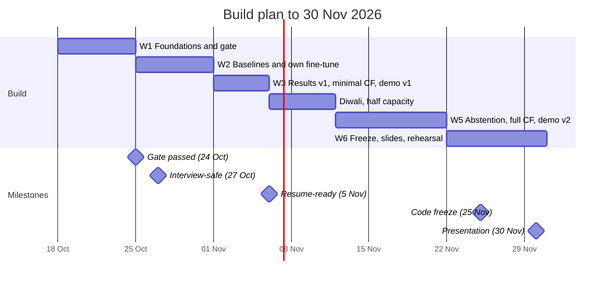

# Project plan: Verifiable Knowledge-Graph QA (Project #8)

> New to the problem? Read [docs/01-problem-explained.md](docs/01-problem-explained.md) first.

## Context

| | |
|---|---|
| Who | Solo, final year, campus placements ongoing |
| Deadline | **Presentation on 30 Nov 2026** (a live demo is a plus) |
| Target | **Product AI roles** (AI Engineer / ML Engineer), so no research paper for now |
| Hardware | Laptop RTX 3050 **4 GB VRAM**, **16 GB RAM**; free Kaggle and Colab; free LLM APIs |
| Realistic time | ~2–3 focused hours/day, minus drive/interview days and Diwali (6–11 Nov). Roughly **90 hours in total** |

## Positioning

- **Course title:** *When to Trust the Knowledge Graph: Neuro-Symbolic Multi-Step QA over Wikidata under Counterfactual Facts*
- **Resume / GitHub title:** *Verifiable Knowledge-Graph QA Agent: LLM-to-program compilation, symbolic execution, verification and abstention*
- **Pitch:** a QA engine over a Wikidata knowledge graph. It compiles questions into executable programs, shows its work, follows the data when facts change, and says "I don't know" when it should. It is benchmarked against an LLM given the facts it needs.

## Scope

**Must have.** These are what the presentation needs.

- **Data and engine:** KQA Pro and the KoPL engine (reused and credited).
- **Executor gate,** a sanity check: run the *correct* programs on all 11,797 validation questions. They must reproduce **≥99%** of the gold answers, or our setup is broken and no other number can be trusted. Questions that fail are excluded everywhere and counted.
- **Parser:** BART-base, starting from the **released fine-tuned checkpoint** (KQAPro_Baselines). Then our own fine-tune, so the resume can truthfully say "fine-tuned". Both are reused and credited.
- **Verifier with beam fallback.** Beam search gives the parser's top-5 candidate programs. The verifier checks each one in turn and keeps the first that passes:
  - it parses;
  - its function names exist;
  - its relation, attribute and concept names exist in the KB;
  - it runs without errors;
  - its result is non-empty and of the right type.

  This replaces the "send the error back" repair loop, because BART can't read error messages.
- **Abstention.** Confidence is the share of the 5 beams that run to the same answer. The threshold is tuned on the dev split only.
- **Baselines** on one *pinned* open 7–8B model (a free downloadable model, always the exact same version):
  - **Baseline A, closed-book:** memory only. Run on 300 questions, just for framing.
  - **Baseline B, oracle-retrieval:** given the facts as text. This is the main comparison; see the [protocol](#baseline-b-context-protocol).
- **Evaluation harness:**
  - fixed, seeded splits;
  - a single scoring rule applied to every system;
  - every LLM call cached;
  - 95% confidence intervals (a ± range showing how much a score could move with a different sample);
  - paired significance tests;
  - results split by number of steps and by question type.
- **Error attribution:** compare each predicted program with the gold one and sort it into a bucket (exact / right shape but wrong detail / wrong shape / doesn't run). Then swap in gold details one kind at a time.
- **Cost and latency per question.** This comes for free from the cache.
- **Minimal counterfactual table:** about 200 questions with *attribute* edits (dates, numbers, strings), plus one extra Baseline B run.
- **Local demo (Gradio):**
  - question → program → per-step trace → answer;
  - Baseline B's answers shown side by side (cached);
  - an "edit this fact" toggle;
  - an "I don't know" badge;
  - it works offline.
- **README:** results table at the top, plus a "reused vs built" section and the licences.

**Stretch.** Only if ahead of schedule.

- Full counterfactual test: relation edits (e.g. a birthplace), and a "memory-conflict" subset report.
- Missing-fact (deletion) test, including silent failures on counts.
- Few-shot LLM parser vs fine-tuned BART: the accuracy / cost / latency tradeoff. Error-message repair is only possible with an LLM parser.
- Tool-calling agent baseline using the same KB functions.
- Pareto plot: a chart of accuracy vs cost showing the best tradeoffs.
- One explicit rule ("located in" is transitive), applied before execution.
- MCP server: lets other AI apps call our KB as a tool.
- A recruiter-facing hosted version (see [Demo](#demo)).
- A small (~200-question) frontier-model reference run on a free API.

**Out for now:** extra datasets, probabilistic logic, live Wikidata queries, a paper. You don't need to know these names.

## Baseline B context protocol

The full KB can't fit in a prompt, so for each question Baseline B gets:

1. **Support facts:** the facts the gold program reads while it runs.
   - These come from each step's **inputs, not its outputs**. For a filter step, include the filtered value of *every* input entity, not just the survivors. Otherwise count and filter questions become free.
   - Collected by a small wrapper around `KoPLEngine.forward` that records each step.
2. **Distractors:** about 10 facts from the starting entities' neighbourhood. These are added, then all lines are shuffled.
3. **Format:** one fact per line, `subject | relation | object | qualifiers`.
4. **Cap:** 150 facts (~4k tokens). Questions over the cap are left out of the hybrid-vs-B table. They are reported as **"context overflow: X% of count questions"**, which is a finding in itself. Fix the cap only after looking at a histogram of support sizes in week 1.
5. **Answer format:** the last line must be `ANSWER: <value>`. Tell the model to copy names and units exactly as written in the facts.
6. **Naming:** call it "oracle-retrieval Baseline B" everywhere (slides, resume), because it is a best case for the LLM.

## Data splits and scoring

- **Splits:** a seeded `data/splits.json`, committed in week 1:
  - **`dev_tune`:** 1,000 questions held out from the *training* set. Used for picking BART checkpoints and the abstention threshold.
  - **`prompt_dev`:** 100 questions from validation. Used only for prompt iteration.
  - **`main`:** 1,000 questions from validation.
    - Stratified, i.e. the same mix as the full set, by question type (multihop, qualifier, comparison, logical, count, verify, zero-shot) and by step bucket (≤3 / 4–5 / 6–7 / ≥8 functions in the gold program).
    - Oversample long programs.
    - Exclude questions that failed the gate.
  - **`cf_pool`:** counterfactual candidates drawn from `main`.
  - The parser alone is also scored on all 11,797 validation questions. That's cheap, with no LLM involved.
- **Scorer:**
  1. strip and lowercase;
  2. map yes/no;
  3. remove thousands separators;
  4. apply the reused `whether_equal` from KQA Pro's `evaluate.py` (it handles units and dates), the same for every system.

  Log the LLM's answer-parse failures separately. Hand-check 50 LLM answers marked wrong and report the scorer's false-negative rate.
- **Statistics:**
  - Wilson intervals for single accuracies.
  - A paired bootstrap (10k resamples) or McNemar test for hybrid vs B.
  - n = 1,000 gives about ±2 points overall and ±6–8 points per bucket.

## Counterfactual test mechanics

- **Version 1 uses attribute edits only**, because they're safe to apply in place:
  - shift a date or year by 7–15 years;
  - scale a number by ×1.5 or ×0.6 (same unit);
  - swap a string.
- **Relation edits (stretch)** must change both stored directions of the fact. Then rebuild the engine from a fresh copy of `kb.json`, since its indexes go stale otherwise. Check that the replacement entity exists.
- **Validity checks for every edit:**
  - the edited fact is on the gold program's trace;
  - the new gold answer differs from the old one;
  - the gold program still runs;
  - Baseline B's context is regenerated from the edited KB and contains the edited fact.

  Spot-check 20 edits by hand.
- **The memory-conflict subset:** the LLM can only "trust memory over the KB" if it knew the original fact. So tag the questions where Baseline A got the *original* answer right, and report KB-following separately for this subset and the rest. The hybrid serves as the control.

## Where things run

| Resource | Use for | Don't use for |
|---|---|---|
| Laptop (4 GB VRAM, 16 GB RAM) | KB and executor (CPU); BART-base inference; verifier; all analysis from the cache; the demo. Fallback: run the same 8B model as a 4-bit GGUF with partial GPU offload overnight (~300 questions per night) | Training. Live 8B inference during the demo (it's too slow at 4 GB) |
| Kaggle (**T4 ×2**, not P100: vLLM needs a newer GPU) | BART fine-tune; Baselines A/B with the pinned model, one process per GPU | Interactive work. Every job is a background "Save & Run All" that finishes in under 8 h and writes the cache as it goes |
| Colab free | Backup when Kaggle quota runs out | Anything that needs a guaranteed GPU |
| Free APIs (NVIDIA NIM ~40 req/min; Groq ~1k req/day but ~100k tokens/day; OpenRouter free 50 req/day; Gemini Flash's free tier is small and varies) | Prompt prototyping; the optional reference run, spread over 1–3 days with caching | Main results: rate limits apply and models change without notice |

> **Consumer subscriptions:** India's free consumer offers are app subscriptions. **ChatGPT Go has no API access.** Google AI Pro has no API key either, but AI Pro subscribers can reportedly activate monthly Google Cloud credits usable for the Gemini API. Check whether the Jio plan qualifies. Either way, don't build main results on it.

**Model and engine choices (pin by 24 Oct, record in the decisions log):**

- **Model:** an *ungated* (no licence form) 7–8B instruct model, recording its exact Hugging Face revision and 4-bit quant.
- **Engine:** llama.cpp server or transformers + bitsandbytes. Give vLLM-on-T4 at most 1 hour of setup.
- **Generation settings:**
  - `max_new_tokens = 512`
  - "thinking" mode off
  - log how often outputs get truncated
- **Budget:** Baseline B ≈ 1,000 questions × (1.5–4k prompt + ~300 output tokens), roughly 3–6 T4-hours.

### BART fine-tune recipe (Kaggle T4)

- **The reused training script is heavy as shipped:**
  - 25 epochs, fp32
  - pads everything to the dataset maximum
  - full validation after every epoch
  - pins `torch 1.12` and `transformers 4.16`
- **Port it to current libraries** (budget 1 day):
  - fp16 mixed precision
  - dynamic padding
  - 3–5 epochs
  - validation on the 1k `dev_tune` split only
  - a checkpoint saved every epoch
- **Time 200 steps first** and extrapolate before committing a 12-hour session.
- **Report against the released checkpoint:** our model's accuracy next to the released one's, e.g. "reproduced within N points".

## Demo

- **Live on the laptop:** BART → program → per-step trace table → answer. Use a copy of `forward()` that *returns* each step's result instead of printing it.
- **Baseline B panel:** cached answers from the pinned 8B run for ~20 curated questions, labelled "cached, <model revision>". Never swap in a smaller local model, because that would misrepresent the baseline.
- **Edit toggle:**
  - attribute edits are applied in place, so they're instant;
  - relation edits are loaded from pre-built KBs;
  - Baseline B's answers on the edited facts are precomputed.
- **Offline-safe:**
  - `HF_HUB_OFFLINE=1`
  - `TRANSFORMERS_OFFLINE=1`
  - `GRADIO_ANALYTICS_ENABLED=False`
  - a pickled KB
  - a recorded backup video
- **Recruiters (stretch):** free Hugging Face Spaces that run an app appear to need a paid plan now; check when we get there. Fallbacks: a static trace explorer on GitHub Pages, or the laptop with a tunnel during interviews.

## Data, cache and repo hygiene

- **Raw data:** upload the KQA Pro zip once (record its checksum) as a **private Kaggle Dataset** and attach it to every notebook. **Never commit** `kb.json` or `train.json`.
- **What gets committed:**
  - `splits.json`
  - `prompts/` (versioned)
  - support sets and edits as `.jsonl`
  - results CSVs
- **LLM cache:**
  - a SQLite file keyed by `sha256(model revision, quant, prompt version, prompt, params)`;
  - stores the output, tokens in/out and latency;
  - after each run, publish it as a new Kaggle Dataset version and mirror it as a GitHub Release asset.
- **CI** (tests that run automatically on every push):
  - `ruff` + `pytest` on a tiny 10-entity fixture KB (the 3 Idiots graph from the explainer);
  - tests cover the trace wrapper, the support extractor, the edit function and the scorer.
- **Gate report:** the gate script also records KB build time and peak RAM in `gate_report.json`.

## Timeline

| Dates | Build | Go / no-go check |
|---|---|---|
| **18–24 Oct** | Raw data as a Kaggle Dataset; KoPL engine; gate script; released BART checkpoint scored on all validation questions; `splits.json`; trace wrapper and support extractor (plus histogram); check whether the demo's example entities exist in `kb.json`; pin the model; cache; repo, CI and fixture KB | **Fri 24 Oct:** gate ≥99%, parser accuracy known, support-size histogram done, model pinned |
| **Tue 27 Oct** | — | **Interview-safe:** you can truthfully describe the design, the gate and the parser's validation accuracy |
| **25–31 Oct** | Baseline B prompt and scorer on `prompt_dev`; Baseline B on `main` (background Kaggle job); Baseline A on 300 questions; own BART fine-tune; beam verifier (laptop) | **Sat 31 Oct:** both baselines cached; own fine-tune done, or the released checkpoint kept and the reason noted |
| **1–5 Nov** | Results table with confidence intervals; accuracy by steps and question type; error buckets; cost/latency table; minimal counterfactual (~200 attribute edits) + Baseline B run; demo v1; README | **Thu 5 Nov: resume-ready.** Resume line v1 with real numbers |
| **6–11 Nov** (Diwali) | Half capacity. Laptop-only tasks (abstention curve, demo polish) plus one unattended Kaggle job | — |
| **12–21 Nov** | Abstention vs coverage for both systems; memory-conflict analysis; edit toggle in the demo; stretch items if ahead | Counterfactual table final |
| **22–30 Nov** | **Code freeze 25 Nov.** Slides, offline rehearsal, backup video, LinkedIn post | Demo runs end to end with Wi-Fi off |

**If only the first three weeks get finished, present:** the gate, the parser vs oracle-B table (with confidence intervals, by steps and type), the minimal counterfactual table, and demo v1. That is already a complete talk.

**If behind schedule, cut in this order:**

1. Stretch items (including the frontier-API run).
2. Error attribution reduced to the four program buckets.
3. Abstention reduced to beam agreement plus empty/wrong-type checks.
4. Live edit toggle replaced by precomputed examples.

**Never cut:** the executor gate, Baseline B, the results table, the **minimal counterfactual table**, the demo.

## Time budget during placements

- Spend roughly half of your prep time on the project and half on DSA, aptitude and interview prep.
- On drive or interview days, do no project work. The plan already assumes those days are lost.
- **Before 27 Oct:** in interviews, talk about the design and why you chose it. Don't quote numbers you don't have yet.
- **Add your end-semester exam dates** to the gantt as blocked days once you know them.

## Resume lines (fill in with measured numbers only)

- **v1, by 5 Nov:**
  > Built a verifiable question-answering agent over a Wikidata knowledge graph. A fine-tuned BART parser compiles questions into executable KoPL programs that a symbolic engine runs. It reaches **[X]%** vs **[Y]%** for an 8B LLM given oracle-retrieved facts (n = 1,000, paired test), and the gap grows to **[g]** points on questions with 6+ steps.
- **v2, after the counterfactual runs:**
  > Under **[N]** counterfactual KB edits it followed the updated fact **[A]%** of the time vs **[B]%** for the LLM. Abstention raises answered-accuracy to **[d]%** at **[c]%** coverage. Fully cached evaluation harness on free GPUs.

## Before starting (by 21 Oct)

- [ ] Show the instructor the reframed scope and ask four questions:
  1. Does running KoPL programs count as "symbolic inference", or are explicit logic rules expected?
  2. Is reusing the KQAPro_Baselines code and its released checkpoint allowed?
  3. Is using the validation set as the test set acceptable?
  4. Is an LLM given oracle facts acceptable as the neural-only baseline?

  Also check the course policy on AI assistance.
- [ ] Phone-verify your Kaggle account (GPU access requires it).
- [ ] Get one or two free API keys and keep them in `.env` (never commit them).

## Decisions log

| Date | Decision | Why |
|---|---|---|
| 17 Oct | Product roles: no paper | A paper adds little for product hiring; the demo, evals and repo matter more |
| 17 Oct | Build on KQA Pro + KoPL; reuse and credit the existing engine, parser and checkpoint | Gold programs make evaluation and the counterfactual test cheap; reuse saves weeks |
| 17 Oct | Baseline B = oracle-retrieval facts (gold-program inputs + distractors, capped at 150) | A fair "same facts" comparison; overflow is reported, not hidden |
| 17 Oct | Repair loop = beam fallback, not error feedback | A fine-tuned BART can't read error messages |
| 17 Oct | Minimal counterfactual (attribute edits) moved to week 3 and made never-cut | It's the project's contribution, so it can't sit at the end of the plan |
| 17 Oct | Test on the official validation set; tune on a split held out from training | Test answers are hidden; tuning and reporting on the same split would inflate results |
| 17 Oct | No training on the laptop (4 GB VRAM) | Fine-tune on Kaggle T4; the laptop runs inference, analysis and the demo |
| 17 Oct | Dropped probabilistic logic, the fallback router and extra datasets | Too much for one person by 30 Nov |
