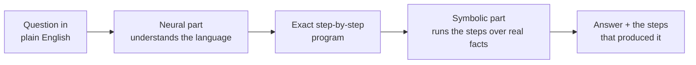
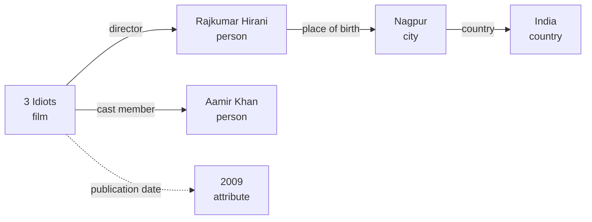
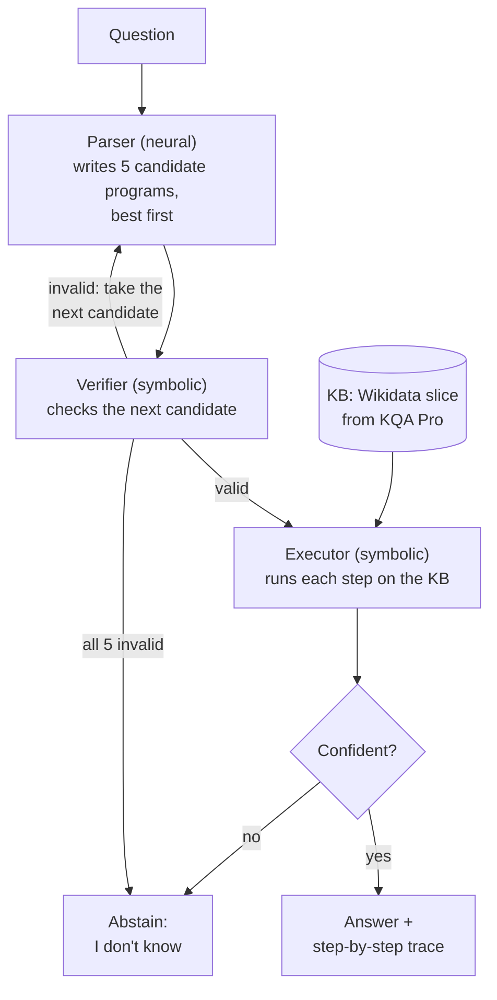
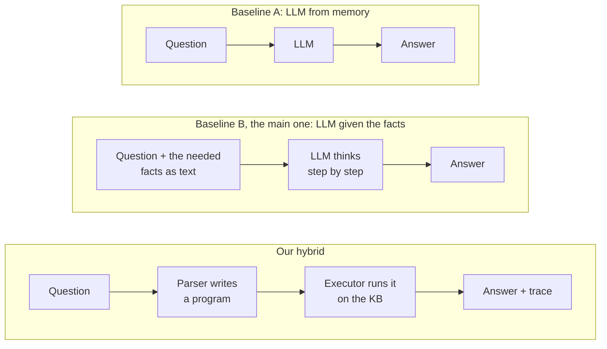
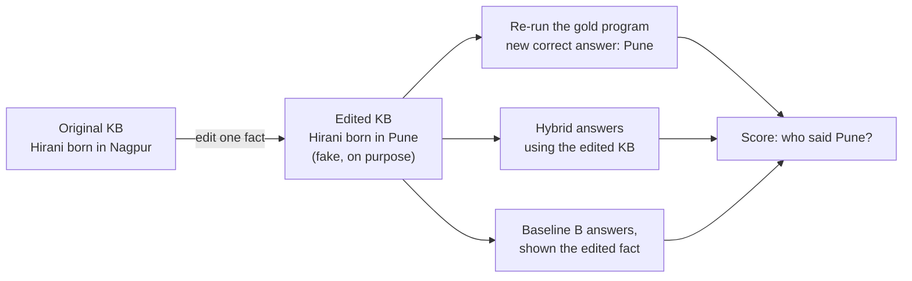

# Project #8, explained simply

> **Neuro-Symbolic Reasoning for Multi-Step Question Answering**
>
> - **Dataset:** Wikidata + a question-answering benchmark
> - **Expected contribution:** combine *neural entity/relation extraction* with *symbolic inference*, and compare against a *neural-only baseline*

*Stuck on a word? Jump to the [Glossary](#11-glossary).*

---

## 1. The whole project in one picture

**In one sentence:** build a system that answers questions needing several facts chained together. A neural model *reads* the question, and a logic engine *does the reasoning* over facts from Wikidata.

**The one question the project answers:**

> Given the **same facts**, is it better to let an LLM reason in its head, or to have it write a **program** that a logic engine runs?

**Why it matters:** every company building a chatbot over its own data (prices, policies, stock) needs answers that are **correct**, **checkable**, and that **change when the database changes**.

**Analogy: a maths word problem.**

- *"Riya buys 3 boxes of 12 pens and 5 loose pens. How many pens?"*
- **Reading it and writing `3 × 12 + 5`** is the language part. It's hard for ordinary rule-based programs and easy for neural networks.
- **Working out `3 × 12 + 5 = 41`** is mechanical. A calculator never gets it wrong.
- LLMs often read the problem correctly but then slip on the working, especially when there are many steps.
- **In our project:**
  - the *equation* = a short program (in a language called KoPL)
  - the *calculator* = the KoPL engine
  - the *numbers* = facts stored in Wikidata

---

## 2. What you'll show on 30 Nov

- **A small web app on your laptop** (built with Gradio):
  1. Type a question.
  2. See the **program** the system wrote.
  3. See **each step's result** (the *trace*).
  4. See the **answer**, with the plain LLM's answer next to it.
- **An "edit this fact" toggle:** change a fact (e.g. a director's birthplace) and watch which system follows the change.
- **An "I don't know" badge** when the system isn't confident.
- **One results table:** accuracy by number of steps, and how often each system follows edited facts.

---

## 3. Decoding the title, word by word

| Term | Simple meaning | Example |
|---|---|---|
| **Question answering (QA)** | A system takes a question and returns an answer | "Where was the director of *3 Idiots* born?" → **Nagpur** |
| **Multi-step** | The answer needs several facts chained together | Step 1: director of *3 Idiots* = Rajkumar Hirani. Step 2: his birthplace = Nagpur |
| **Neural** | Neural networks and LLMs. They learn patterns from data and are great with language, but they *guess* | A ChatGPT-style model |
| **Symbolic** | Explicit facts, rules and programs. Exact and checkable, but rigid | A database query, an Excel formula, a calculator |
| **Neuro-symbolic** | Neural for *understanding*, symbolic for *reasoning* | This project |

### Why not just use one of them?

| | Neural only (LLM) | Symbolic only (logic engine) |
|---|---|---|
| Understands messy, natural language | ✅ Yes | ❌ Needs exact, formal input |
| Exact multi-step reasoning, counting, comparing | ⚠️ Makes mistakes, and more steps mean more mistakes | ✅ Exact every time |
| Can show *how* it got the answer | ❌ Its explanation may not be how it really decided | ✅ Every step can be traced |
| Facts can be updated | ❌ Memory is frozen when training ends | ✅ Just edit the database |
| When a fact is missing | Often makes something up (*hallucination*) | Usually returns nothing, so you can see something is missing. For counts it can return a number that is quietly one too low (§8) |

Neuro-symbolic tries to get the **language skill from the left column** and the **exactness from the right column**.

---

## 4. What is Wikidata? (the "knowledge graph")

- **Wikidata** is Wikipedia's free sister project: a database of facts. Many facts in Wikipedia's info-boxes come from it.
  - It has about 119 million items.
  - Anyone can use it for anything (a public-domain licence called CC0).
- Every fact is a **triple**: `(subject, property, object)`, for example:
  - `(3 Idiots, director, Rajkumar Hirani)`
  - `(Rajkumar Hirani, place of birth, Nagpur)`
- **Why IDs?** Many things share a name, so each one gets a unique code. You won't need to memorise any.
  - Items start with Q: India = `Q668`.
  - Properties start with P: director = `P57`, place of birth = `P19`, publication date = `P577`.
- **Our benchmark (§5) splits properties into two kinds:**
  - **relations**, where the value is another thing (*director → Rajkumar Hirani*);
  - **attributes**, where the value is a plain value such as a date or number (*publication date → 2009*).

**How to read this picture:**

- **Solid arrows** link two things (*relations*).
- **The dotted arrow** points to a plain value (an *attribute*).
- **The small word under each name** (film, person, city) is its type, called a **concept**.

**A multi-step question is a walk along the arrows.**

- "Where was the director of *3 Idiots* born?" means: start at *3 Idiots* → follow **director** → follow **place of birth** → arrive at **Nagpur**.
- Two arrows leave *3 Idiots*. The question says "director", so we take that one, not "cast member". **Picking the right arrows is exactly the neural part's job.**
- Each arrow you follow is a **hop**. This question has 2 hops. Harder questions have more hops, or add counting, comparing and filtering.

All these facts together are called a **knowledge graph**, or **knowledge base (KB)**. In this doc the two mean the same thing, and we'll mostly say **KB**.

---

## 5. The benchmark we'll use: KQA Pro

A *benchmark* is a fixed set of questions with known correct answers, used to score systems fairly.

- **About 118,000 questions:**
  - ~94k for training
  - ~11.8k for validation
  - ~11.8k for test, whose answers the authors keep secret. So we use the validation set as our test set, and hold back part of the training set for tuning.
- **The questions run over a slice of Wikidata** of about 17,000 entities. That's small enough for a laptop.
- **What makes KQA Pro special:** every question comes with its answer **and the exact step-by-step program that computes it**. That program is the "gold" (officially correct) reasoning.
- **The programs are written in KoPL** (Knowledge-oriented Programming Language). It's nothing like Python: a KoPL program is just a list of steps such as *find this, follow that arrow, count*.
- **Question types:** multi-hop, counting, comparison, yes/no verification, conditions such as "in 2010", and AND/OR combinations.

**Why gold programs matter to us:**

1. We can **train our parser** by showing it ~94k question → program pairs.
2. If we **change a fact**, we can re-run the program and get the new correct answer for free (§8).

### How to read a program

| Step | What it does |
|---|---|
| `Find(X)` | Start at the dot named X |
| `Relate(r)` | Follow arrow *r* to the next dot |
| `Relate(r, backward)` | Walk arrow *r* in reverse. The arrow points *film → director → Nolan*, so starting at Nolan and walking backward reaches all of his films |
| `FilterConcept(film)` | Keep only the dots whose type (concept) is *film* |
| `QueryAttr(a)` | Read the value of attribute *a* (e.g. a date) |
| `SelectBetween(a, greater)` | Of two things, pick the one with the bigger value of attribute *a* (numbers only) |
| `Count()` / `What()` | Return how many / return the name |

### What questions and programs look like

| Type | Question | Program (KoPL, simplified) | Answer |
|---|---|---|---|
| Multi-hop | Where was the director of *3 Idiots* born? | `Find(3 Idiots) → Relate(director) → Relate(place of birth) → What()` | Nagpur |
| Comparison | Which city has a larger population, Mumbai or Nagpur? | `Find(Mumbai)` and `Find(Nagpur)` → `SelectBetween(population, greater)` (two starting points feed one step) | Mumbai |
| Counting | How many films did Christopher Nolan direct? | `Find(Christopher Nolan) → Relate(director, backward) → FilterConcept(film) → Count()` | *Whatever the KB says* |
| Yes / No | Was *3 Idiots* released after 2005? | `Find(3 Idiots) → QueryAttr(publication date) → VerifyYear(2005, >)` | Yes |

> **Why "whatever the KB says"?** The KB is a frozen snapshot. The "correct" count is what *that snapshot* contains, which may differ from today's real world and from what an LLM remembers. This is why judging an LLM by memory alone on KQA Pro is unfair (§7).

> **About these examples:** they use real Wikidata facts so they're easy to follow. KQA Pro's slice was built mostly from popular, Western-heavy entities, so *3 Idiots* may not be in it. In week 1 we check, and if needed the demo uses an example that really is in the KB.

---

## 6. The system we'll build (the hybrid)

What each box does:

- **Parser (neural):** reads the question and writes the program.
  - This is the brief's **"neural entity/relation extraction"**: it works out *which entities* (3 Idiots) and *which relations* (director, place of birth) the question is about, and in what order.
  - **The model is BART-base**, a small open text-to-text model with ~140M parameters, compared with 7–8 *billion* for the LLM we compare against.
  - *Fine-tuned* means we train it further on KQA Pro's ~94k question → program pairs.
  - **Why small?** With that much example data, a small model learns the program language very well (the KQA Pro authors report about 90% accuracy), and it runs free on a laptop.
  - It writes its **top 5 guesses** (a method called *beam search*), best first.
- **Verifier (symbolic):** checks a candidate program *before* trusting it.
  - Do "director" and "place of birth" really exist in the KB?
  - Do the steps fit together? For example, you can't ask for the *place of birth* of a year like 2009.
  - Does it run without errors?
  - If a candidate fails, we try the next one. If all 5 fail, the system says "I don't know".
- **Executor (symbolic):** runs every step exactly over the KB. No guessing.
- **Confidence check:**
  - **Agreement:** we run several of the 5 candidates. If most give the same answer, we trust it.
  - **Sanity checks:** we reject an answer that is empty, or that is the wrong kind of thing (the question asks "when?" but the answer is a city).
  - Otherwise the system **abstains**, saying "I don't know". That's better than a confident wrong answer.
- **Trace:** the output is the answer **plus the actual steps that ran**, with their intermediate results. That is a real explanation, not a story written afterwards.

### Walkthrough: "Where was the director of *3 Idiots* born?"

This table is exactly the trace the system shows you:

| Step | Operation | Result after this step |
|---|---|---|
| 1 | `Find(3 Idiots)` | *3 Idiots* (the film) |
| 2 | `Relate(director)` | Rajkumar Hirani |
| 3 | `Relate(place of birth)` | Nagpur |
| 4 | `What()` | **"Nagpur"**: the final answer. Steps 1–3 are its proof |

> **What already exists vs what we add**
>
> - **Already exists (we reuse it and credit the authors):**
>   - the KQA Pro dataset
>   - the KoPL engine
>   - a BART parser that turns questions into KoPL programs (the *KQAPro_Baselines* code)
> - **What we add:**
>   1. the verifier and "I don't know" checks
>   2. a fair LLM baseline that gets the same facts (§7)
>   3. the changed-fact stress test (§8)
>   4. the evaluation and the demo

---

## 7. The neural-only baselines (what we compare against)

A **baseline** is the simpler system you must beat to show your idea is worth it.

- **Baseline A is unfair on its own.** It can't know the frozen KB's exact counts and dates, so it loses for the wrong reason. We still run it, because it shows how much an LLM relies on memory.
- **Baseline B is the fair fight.** It is given the facts it needs, so the **main difference is the reasoning style**: reasoning in its head vs writing a program.

**How do we pick the facts for Baseline B?**

- The full KB is far too big for a prompt, so for each question we collect the facts that the **correct program reads while it runs**. For "Where was the director of *3 Idiots* born?" that's two lines:
  - `3 Idiots | director | Rajkumar Hirani`
  - `Rajkumar Hirani | place of birth | Nagpur`
- **Distractors and a cap:**
  - We add about 10 unrelated nearby facts as distractors and shuffle the lines.
  - We cap the list at ~150 lines.
- **This is the best case for the LLM.** We hand it exactly the facts it needs (called *oracle retrieval*). If it still loses, that's strong evidence.
- **Some questions need more than 150 facts**, such as counting over thousands of films. We report those separately, because "the facts don't even fit in the prompt" is a finding in its own right.
- **Baseline B may also say "I don't know"**, so the abstention comparison is fair.

Where each one tends to fail:

- **LLM (Baseline B):** loses count over long lists, mixes up dates, makes more mistakes as steps pile up, and sometimes ignores the given facts in favour of what it memorised.
- **Hybrid:** the parser writes a wrong program (for example, *producer* instead of *director*), misreads an unusual phrasing, or the needed fact isn't in the KB.

---

## 8. Our twist: what if the facts change or go missing?

This is what makes the project more than a re-run of the KQA Pro authors' work, and it's also the most memorable part of the demo.

### Test 1: a changed fact (a *counterfactual*, false on purpose)

- **New correct answers for free.** KQA Pro gives us the gold program, so after editing a fact we **re-run it to get the new correct answer automatically**, for thousands of questions, with no manual labelling.
- **The hybrid** should now answer *Pune*, because it reads the KB.
- **Baseline B** is *shown* "Hirani | place of birth | Pune", yet it may still say *Nagpur*, trusting its memory over the facts it was given.

**Is this rigged in favour of the hybrid?** Partly, and that's the point: it shows the hybrid follows the data. The interesting numbers are:

1. **How often Baseline B ignores a fact it was given** and answers from memory. This can only happen when the LLM *knew* the original fact, so we report separately the questions where Baseline A (memory only) got the original answer right.
2. **How often the hybrid's own parser mistakes still get through.**

**Rules that keep the test honest:**

- **Only edit facts the question's program actually uses.** Otherwise the answer can't change and the test tells us nothing.
- **The new answer must differ from the old one.** Same reason.
- **Always label edited answers as counterfactual**, so fake facts are never mistaken for real ones in slides, the demo or shared data.

### Test 2 (bonus, if time allows): a missing fact

- Delete a fact the question needs.
- **Loud failure (good):** the hybrid gets an empty result and says "I don't know". Baseline B, by contrast, often fills the gap from memory or guesses.
- **Silent failure (dangerous):** for "How many films did Nolan direct?", deleting one film makes the count *one lower*, and it still looks like a normal answer.
  - We can *measure* how often this happens, because we know which fact we deleted.
  - Our checks can't *catch* it: an answer of 8 instead of 9 looks completely normal. We'll report this honestly as a limitation.

### Why companies care

Every company building an "AI assistant over our data" has exactly this problem:

- Prices, policies and inventory change.
- The assistant must **follow the database, not its memory**, and **say "I don't know"** when data is missing.

The words you'll hear in AI Engineer interviews map straight onto this project:

- **Text-to-SQL:** an LLM turns a question into a SQL query and the database runs it. It's the same idea as our parser, with SQL instead of KoPL.
- **GraphRAG:** an LLM answers using facts fetched from a knowledge graph, like our Baseline B.
- **Tool-using agents:** an LLM calls functions (search, database, calculator) instead of guessing, and the calls are checked before anyone trusts them, like our verifier.

---

## 9. How we'll measure success

- **Accuracy,** overall and split by number of steps. Expected: the LLM's accuracy drops as the number of steps grows, and the hybrid's stays flatter.
- **Where the hybrid's errors come from.** We compare each program the parser wrote with the correct one and sort it into a bucket:
  - exact match
  - right shape, wrong detail (wrong entity, relation or number)
  - wrong shape
  - doesn't run

  For "right shape, wrong detail", we fix one kind of detail at a time and re-run. *Made-up example:* the hybrid scores 80%. Fixing entity names lifts it to 86%, so about 6 points of error came from picking the wrong entities. This tells us which part to improve next.
- **KB-following rate:** after an edit, how often does each system give the *new* correct answer?
- **Abstention quality,** in two numbers:
  - **Coverage:** the % of questions the system answers.
  - **Accuracy when answering:** the % of those it gets right.

  Saying "I don't know" more often raises the second and lowers the first, so we plot one against the other and compare systems at the same coverage.
- **Cost and speed:** LLM calls, tokens and seconds per question. The hybrid uses one small-model call plus a few milliseconds of execution.

---

## 10. How this matches the brief

| The brief asks for | Where it lives in our project |
|---|---|
| Neural entity/relation extraction | The parser picks the entities and relations out of the question and assembles them into a program |
| Symbolic inference | The verifier and executor over the KB |
| Wikidata + a QA benchmark | KQA Pro (built from Wikidata) |
| Comparison against a neural-only baseline | Baseline A (memory only) and **Baseline B (given the facts)** |

**Why does the executor count as "symbolic inference"?**

- Each step is an exact logical operation: follow a relation, filter a set, intersect two sets, compare two values.
- Chaining them produces an answer that isn't written anywhere in the KB. No single fact says "Nolan directed N films", for example.
- If time allows, we add one explicit rule: *located in is transitive*. If Nagpur is in Maharashtra and Maharashtra is in India, then Nagpur is in India.

---

## 11. Glossary

| Term | Meaning |
|---|---|
| **Abstain** | Deliberately answering "I don't know" |
| **Attribute** | A plain value attached to an entity (a date, a number, a height) |
| **Baseline** | The simpler system you compare against |
| **Beam search** | A way for a model to produce its top few guesses, ranked, instead of just one |
| **Benchmark** | A fixed question set with known answers, used to score systems |
| **Concept** | An entity's type (film, person, city) |
| **Counterfactual** | A deliberately false version of a fact, used to test whether a system follows its data |
| **Coverage** | The % of questions a system answers instead of saying "I don't know" |
| **Entity** | A thing in the KB (a film, a person, a city) |
| **Executor** | Runs a program over the KB |
| **Few-shot prompting** | Showing an LLM a few examples in the prompt instead of training it |
| **Fine-tuning** | Further training a pre-trained model on your task's data |
| **Gold** | The officially correct answer or program from the dataset |
| **Hallucination** | A confident answer that isn't supported by any fact |
| **Hop** | Following one relation from one entity to the next |
| **Knowledge graph / knowledge base (KB)** | All the facts together, stored as triples |
| **KoPL** | Knowledge-oriented Programming Language: KQA Pro's step-by-step program format |
| **Oracle** | A setting where a system is handed something it would normally have to find itself (here, the exact facts it needs) |
| **Parser** | Turns a question into a program |
| **RAG** | Retrieval-augmented generation: fetch relevant facts first, then let the LLM answer |
| **Relation** | A link between two entities (*director*, *place of birth*) |
| **Silent failure** | A wrong answer that looks completely normal |
| **Trace** | The list of steps that actually ran, with each step's result |
| **Triple** | One fact: `(subject, property, object)` |
| **Verifier** | Checks a program before it is trusted |

*Licence note: Wikidata is CC0, but KQA Pro (questions, programs and its KB slice) is CC BY-SA 4.0. Anything we publish that is derived from it, such as edited facts, must credit KQA Pro and use the same licence.*
