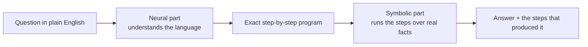
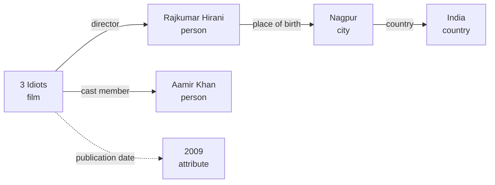
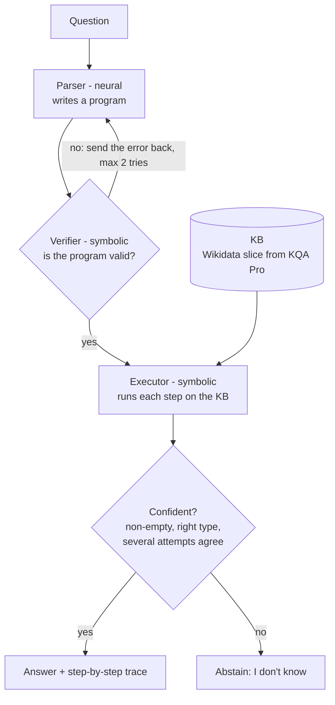
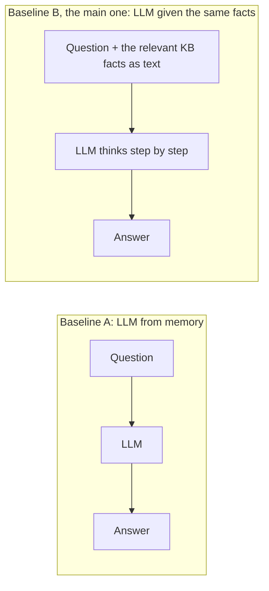
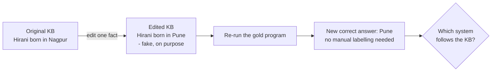

# Project #8, explained simply

> **Neuro-Symbolic Reasoning for Multi-Step Question Answering**
>
> - **Dataset:** Wikidata + a question-answering benchmark
> - **Expected contribution:** combine *neural entity/relation extraction* with *symbolic inference*, and compare against a *neural-only baseline*

---

## 1. The whole project in one picture

**In one sentence:** build a system that answers questions needing several facts chained together. A neural model *reads* the question, and a logic engine *does the reasoning* over Wikidata. Then show whether this beats an LLM working alone.

**Analogy: a maths word problem.**

- *"Riya buys 3 boxes of 12 pens and 5 loose pens. How many pens?"*
- **Reading it and writing `3 × 12 + 5`** is the language part. This is hard for computers and easy for neural networks.
- **Working out `3 × 12 + 5 = 41`** is mechanical and exact. A calculator (symbolic) never gets it wrong.
- LLMs often get the reading right and then slip on the working, especially when there are many steps.
- **Neuro-symbolic** means letting the neural model write the equation and letting the calculator solve it.

---

## 2. Decoding the title, word by word

| Term | Simple meaning | Example |
|---|---|---|
| **Question answering (QA)** | A system takes a question and returns an answer | "Where was the director of *3 Idiots* born?" → **Nagpur** |
| **Multi-step** | The answer needs several facts chained together | Step 1: director of *3 Idiots* = Rajkumar Hirani. Step 2: his birthplace = Nagpur |
| **Neural** | Neural networks and LLMs. They learn patterns from data, are great with language, but they *guess* | A ChatGPT-style model |
| **Symbolic** | Explicit facts, rules and programs. Exact and checkable, but rigid | A database query, a Prolog rule, a calculator |
| **Neuro-symbolic** | Neural for *understanding*, symbolic for *reasoning* | This project |

### Why not just use one of them?

| | Neural only (LLM) | Symbolic only (logic engine) |
|---|---|---|
| Understands messy, natural language | ✅ Yes | ❌ Needs exact, formal input |
| Exact multi-step reasoning, counting, comparing | ⚠️ Makes mistakes, and more steps mean more mistakes | ✅ Exact every time |
| Can show *how* it got the answer | ❌ Its explanation may not be how it really decided | ✅ Every step is traceable |
| Facts can be updated | ❌ Memory is frozen when training ends | ✅ Just edit the database |
| When a fact is missing | Often makes something up (*hallucination*) | Returns nothing, or a quietly wrong count |

Neuro-symbolic tries to get the **language skill from the left column** and the **exactness from the right column**.

---

## 3. What is Wikidata? (the "knowledge graph")

- **Wikidata** is the structured database behind Wikipedia, with over 100 million items. It is free and open (CC0).
- Every fact is a **triple**: `(subject, relation, object)`.
  - `(3 Idiots, director, Rajkumar Hirani)`
  - `(Rajkumar Hirani, place of birth, Nagpur)`
- Everything has an ID. **Items** start with Q (India = `Q668`) and **relations** start with P (director = `P57`, place of birth = `P19`).
- Values such as dates and numbers (e.g. `publication date = 2009`) are called **attributes**.
- Connect all the triples and you get a **graph**: things are dots, relations are arrows.

**A multi-step question is a walk along the arrows.**
"Where was the director of *3 Idiots* born?" means: start at *3 Idiots* → follow **director** → follow **place of birth** → you arrive at **Nagpur**.

Each arrow you follow is called a **hop**. This question has 2 hops. Harder questions have more hops, or add counting, comparing and filtering.

---

## 4. The benchmark we'll use: KQA Pro

A *benchmark* is a fixed set of questions with known correct answers, used to score systems fairly.

- **About 118,000 questions**: ~94k for training, ~11.8k for validation, ~11.8k for test. The test answers are kept secret by the authors, so we use the validation set as our test set.
- They run over a **slice of Wikidata**: about 17,000 entities, small enough for a laptop.
- **What makes it special:** every question comes with its answer **and the exact step-by-step program that computes it**, written in a small language called **KoPL**. That program is the "gold" (correct) reasoning.
- Question types: multi-hop, counting, comparison, yes/no verification, conditions such as "in 2010", and AND/OR combinations.

### What questions and programs look like

The examples below use real Wikidata facts so they're easy to follow. KQA Pro's slice may not contain these exact entities, and the program syntax is simplified.

| Type | Question | Program (KoPL, simplified) | Answer |
|---|---|---|---|
| Multi-hop | Where was the director of *3 Idiots* born? | `Find(3 Idiots) → Relate(director) → Relate(place of birth) → What()` | Nagpur |
| Comparison | Who is older, Virat Kohli or Rohit Sharma? | `Find(Virat Kohli), Find(Rohit Sharma) → SelectBetween(date of birth, less)` | Rohit Sharma |
| Counting | How many films did Christopher Nolan direct? | `Find(Christopher Nolan) → Relate(director, backward) → FilterConcept(film) → Count()` | *Whatever the KB says* |
| Yes / No | Was *3 Idiots* released after 2005? | `Find(3 Idiots) → QueryAttr(publication date) → VerifyYear(2005, >)` | Yes |

> **Why "whatever the KB says"?** The knowledge base (KB) is a frozen snapshot. The "correct" count is what *that snapshot* contains, which may differ from today's real world and from what an LLM remembers. This is why judging an LLM by memory alone on KQA Pro is unfair (see §6).

---

## 5. The system we'll build (the hybrid)

What each box does:

- **Parser (neural):** reads the question and writes the program.
  - This is the brief's **"neural entity/relation extraction"**: it works out *which entities* (3 Idiots) and *which relations* (director, place of birth) the question is about, and in what order.
  - Main option: a small model (**BART-base, ~140M parameters**) fine-tuned on KQA Pro's training programs. It is cheap, fast, and runs on a laptop.
  - Optional comparison: a bigger LLM prompted with a few examples.
- **Verifier (symbolic):** checks the program *before* it runs. Does the relation "director" exist? Do the step types fit together (you can't `Count()` a single name)? If something is wrong, the error message goes back to the parser for another try.
- **Executor (symbolic):** runs every step exactly over the KB. No guessing.
- **Confidence check → abstain:** saying *"I don't know"* is better than a confident wrong answer. A simple way to measure confidence is to have the parser write several programs and check whether they agree.
- **Trace:** the output is the answer **plus the actual steps that ran**, with their intermediate results. That is a real explanation, not a story written afterwards.

### Walkthrough: "Where was the director of *3 Idiots* born?"

| Step | Operation | Result after this step |
|---|---|---|
| 1 | `Find(3 Idiots)` | *3 Idiots* (the film) |
| 2 | `Relate(director)` | Rajkumar Hirani |
| 3 | `Relate(place of birth)` | Nagpur |
| 4 | `What()` | **"Nagpur"** ← final answer, and steps 1–3 are its proof |

---

## 6. The neural-only baselines (what we compare against)

A **baseline** is the simpler system you must beat to show your idea is worth it.

- **Baseline A is unfair on its own.** It can't know the frozen KB's exact counts and dates, so it loses for the wrong reason. We still run it, because it shows how much an LLM relies on memory.
- **Baseline B is the fair fight.** It gets *the same facts* the hybrid can use. Now the only difference is the reasoning style:

> **The core question:** given the *same* facts, is it better to let the LLM reason in its head, or to have it write a program that a logic engine runs?

Where each one tends to fail:

- **LLM (Baseline B):** loses count over long lists, mixes up dates, makes more mistakes as steps pile up, and sometimes ignores the given facts in favour of what it memorised.
- **Hybrid:** the parser writes a wrong program (for example, *producer* instead of *director*), misreads an unusual phrasing, or the needed fact isn't in the KB.

---

## 7. Our twist: what if the facts change or go missing?

This is what makes the project more than a re-run of existing work, and it's also the most memorable part of the demo.

### Test 1: a changed fact (a *counterfactual*, false on purpose)

- KQA Pro gives us the gold program, so after editing a fact we just **re-run that program to get the new correct answer automatically**. That can be done for thousands of questions at no labelling cost.
- The **hybrid** should now answer *Pune*, because it reads the KB.
- The **LLM** may still say *Nagpur*: it trusts its memory over the facts it was given.
- A few rules keep the test honest:
  - only edit facts the question's program actually uses;
  - the answer must actually change;
  - always label edited answers as counterfactual.

### Test 2: a missing fact

- Delete a fact the question needs.
- **Loud failure (good):** the hybrid gets an empty result and abstains, saying "I don't know."
- **Silent failure (dangerous):** for "How many films did Nolan direct?", deleting one film makes the count *one lower*, and it still looks like a normal answer. Measuring and catching these silent failures is a key part of the project.

### Why companies care

Every company building an "AI assistant over our data" has exactly this problem:

- Prices, policies and inventory change.
- The assistant must **follow the database, not its memory**, and **say "I don't know"** when data is missing.

That is why this project maps onto real product work: text-to-SQL, GraphRAG, and tool-using agents with verification.

---

## 8. How we'll measure success

- **Accuracy**, overall and split by number of steps. Expected: the LLM's accuracy drops as the number of steps grows, and the hybrid's stays flatter.
- **Where errors come from:** swap in the correct piece one at a time (correct entity names, then the correct program) and see how much accuracy each fix recovers.
- **KB-following rate:** after an edit, how often does each system give the *new* correct answer?
- **Abstention quality:** when it does answer, how often is it right, and how often does it say "I don't know"?
- **Cost and speed:** LLM calls, tokens and seconds per question.

---

## 9. How this matches the brief

| The brief asks for | Where it lives in our project |
|---|---|
| Neural entity/relation extraction | The parser picks the entities and relations out of the question and assembles them into a program |
| Symbolic inference | The verifier and executor over the KB. Optional: simple rules such as "located in is transitive" (if Nagpur is in Maharashtra and Maharashtra is in India, then Nagpur is in India) |
| Wikidata + a QA benchmark | KQA Pro (built from Wikidata) |
| Comparison against a neural-only baseline | Baseline A (memory only) and **Baseline B (same facts)** |

---

## 10. Glossary

- **Entity:** a thing in the KB (a film, a person, a city).
- **Relation:** a link between two entities (*director*, *place of birth*).
- **Attribute:** a value attached to an entity (a date, a number, a height).
- **Triple:** one fact, `(subject, relation, object)`.
- **Knowledge graph / knowledge base (KB):** all the triples together.
- **Hop:** following one relation from one entity to the next.
- **Parser:** turns a question into a program.
- **Program (KoPL):** the exact list of steps to compute the answer.
- **Executor:** runs the program over the KB.
- **Gold:** the officially correct answer or program from the dataset.
- **Baseline:** the simpler system you compare against.
- **Fine-tuning:** further training a pre-trained model on your task's data.
- **Few-shot prompting:** showing an LLM a few examples in the prompt instead of training it.
- **Hallucination:** a confident answer that isn't supported by any fact.
- **Abstain:** deliberately answering "I don't know."
- **Counterfactual:** a deliberately false version of a fact, used to test whether a system follows its data.
